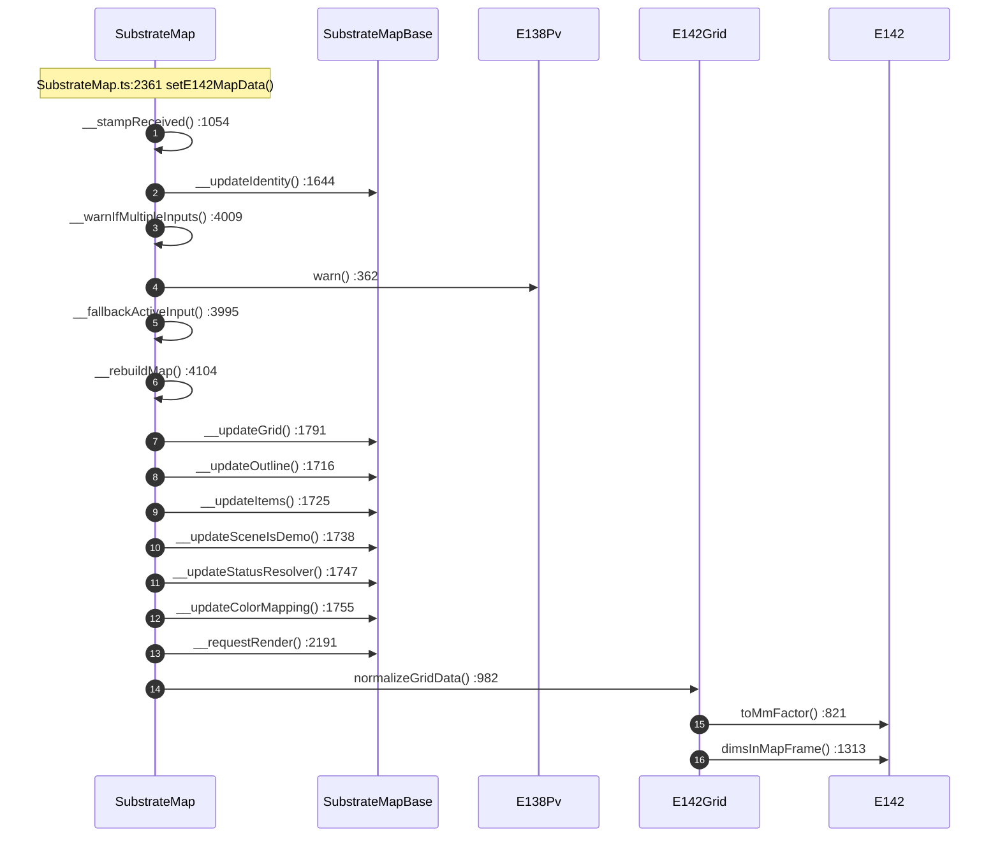
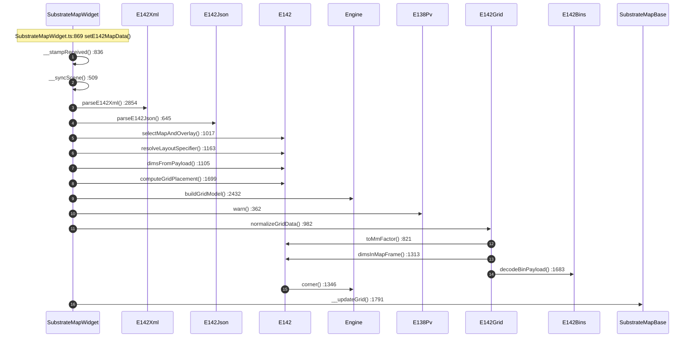
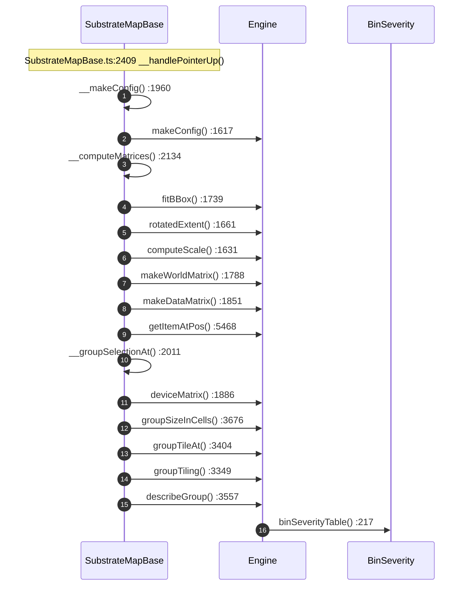
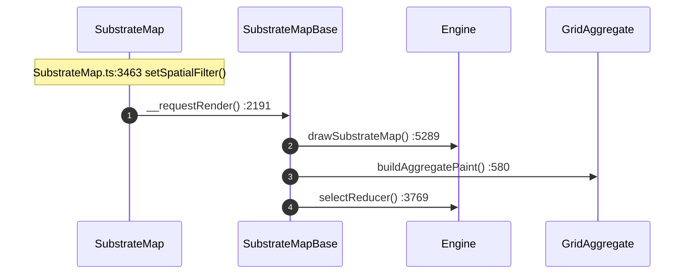
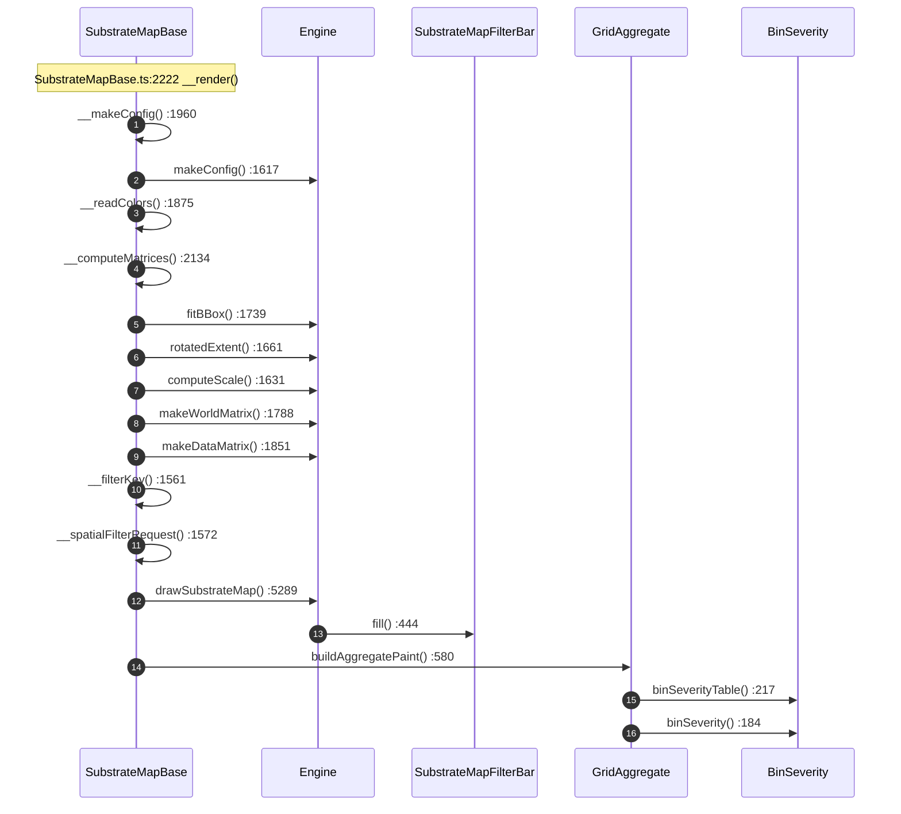

# API call paths

**This document exists so you do not have to start at the top.**

Each section is a symptom, a file and line to break on, and the call chain that follows it. The chains
are **traced from the sources** by `tools/api-sequences.mjs`, so every arrow names a method that is
actually called and a line number that is actually current.

For what the attributes mean, see [README.md](README.md). For how the pieces relate, see
[ARCHITECTURE.md](ARCHITECTURE.md).

<!-- TOC:BEGIN -->
**Contents**

- [How to read these](#how-to-read-these)
- [A document is bound and nothing appears](#a-document-is-bound-and-nothing-appears)
- [A tile says "no data" while holding a document](#a-tile-says-no-data-while-holding-a-document)
- [A click selects nothing](#a-click-selects-nothing)
- [A filter changes nothing](#a-filter-changes-nothing)
- [A frame is drawn](#a-frame-is-drawn)
<!-- TOC:END -->

---

## How to read these

Every arrow is `method()  :line` — the line in the file named by the participant it points at. Open
that file at that line and you are in the frame the diagram is describing.

**Three things these diagrams are not.**

They are a **map, not a recording**. The trace is static: it shows both branches of a choice a given
run makes once. A document is XML *or* JSON, and both arrows are drawn.

They **stop.** Each chain is followed a few levels and no further, because the part you need when
something is wrong is the top — which of four parsers ran, not what the innermost one did on its
eleventh line.

They **cannot follow a call through a value, an event, or the framework.** Where a chain ends at
`TcHmi.EventProvider.raise`, the next thing that happens is in your view, not in this package.

---

## A document is bound and nothing appears

<!-- SEQ:BIND:BEGIN -->
### A document is bound and nothing appears

**Symptom.** You wrote `E142MapData` and the map is empty, or shows the previous lot.

**Start here:** `Controls/SubstrateMap/SubstrateMap.ts:2361` — `setE142MapData()`

<!-- SEQ:BIND:END -->

**What usually happened.** The three map inputs are mutually exclusive and the most recent write wins;
if two are bound, the map logs `E142_MAP_INPUT_OVERRIDDEN` and one of them is dead. If the parse failed,
`E142LastError` holds the reason — read the attribute before stepping into the parser.

---

## A tile says "no data" while holding a document

<!-- SEQ:TILE:BEGIN -->
### A tile says "no data" while holding a document

**Symptom.** The tile is bound and still shows its empty state.

**Start here:** `Controls/SubstrateMapWidget/SubstrateMapWidget.ts:869` — `setE142MapData()`

<!-- SEQ:TILE:END -->

**What usually happened.** A tile accepts `GridData`, `E142MapData` and `E142MapDataJson` and nothing
else. It takes the document's **first renderable map** — it has no attributes with which to choose an
overlay — so a document carrying several substrate maps shows the first, not the one you meant.

---

## A click selects nothing

<!-- SEQ:CLICK:BEGIN -->
### A click selects nothing

**Symptom.** The map draws, the pointer is over a die, and no event arrives.

**Start here:** `Controls/SubstrateMapBase/SubstrateMapBase.ts:2409` — `__handlePointerUp()`

<!-- SEQ:CLICK:END -->

**What usually happened, in order of likelihood.** The control is a tile or a chart, which declare
`__selectionMode = 'none'` and return before hit-testing — that is deliberate. Or the pointer moved
more than the drag slop between `pointerdown` and `pointerup`, and the release was refused as a drag.
Or the cell under the pointer is a null bin, which is inert by design.

---

## A filter changes nothing

<!-- SEQ:FILTER:BEGIN -->
### A filter changes nothing

**Symptom.** The bar moves, the map does not.

**Start here:** `Controls/SubstrateMap/SubstrateMap.ts:3463` — `setSpatialFilter()`

<!-- SEQ:FILTER:END -->

**What usually happened.** Not every filter applies to every channel: averaging filters need a scalar
field and ordering filters need ranked bins. An illegal pair logs `E142_FILTER_NOT_APPLICABLE` and the
map keeps drawing unfiltered. The filter bar grays those combinations and says why in its tooltip; a
direct attribute write gets the log line instead.

---

## A frame is drawn

<!-- SEQ:RENDER:BEGIN -->
### A frame is drawn

**Symptom.** Wrong size, wrong colors, or nothing at all after a resize.

**Start here:** `Controls/SubstrateMapBase/SubstrateMapBase.ts:2222` — `__render()`

<!-- SEQ:RENDER:END -->

**Where to break for what.** Wrong size: the canvas is sized in device pixels from the CSS box and the
device pixel ratio, so a wrong size is almost always the box, not the drawing. Wrong colors: the theme
is read per frame, and a color that is wrong in one theme and right in the other is a theme file, not
the palette. Nothing at all after a resize: the `ResizeObserver` requests a frame rather than drawing
one, so break on the request before the draw.
