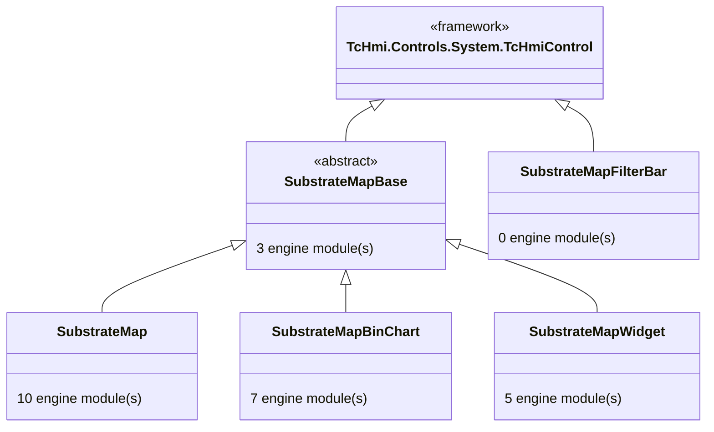
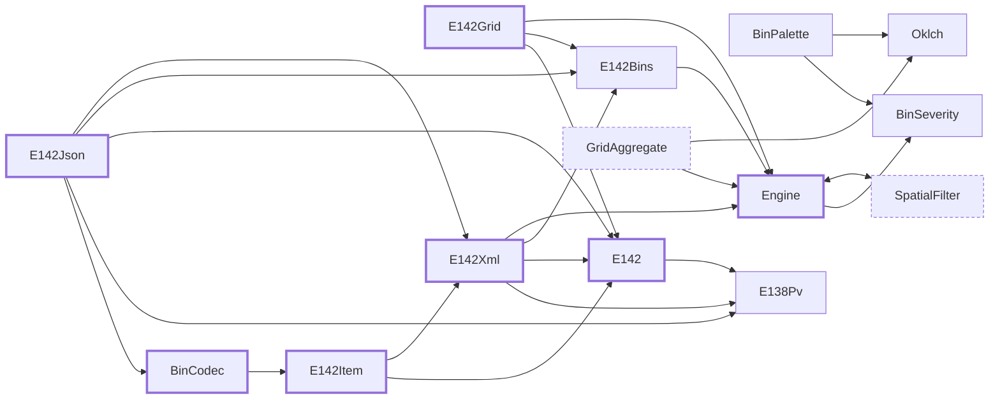
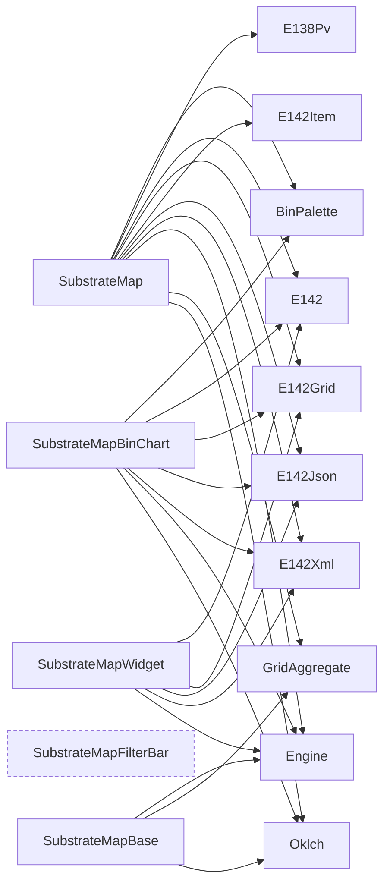

# Architecture

How this package is put together, and why. The diagrams are **generated from the sources** by
`tools/architecture.mjs`, so an arrow that is here is an import that exists; the prose around them is
written by hand, because a graph can say what depends on what and never why.

For the attribute surface and how to use the controls, see [README.md](README.md).

<!-- TOC:BEGIN -->
**Contents**

- [The controls](#the-controls)
- [The engine](#the-engine)
- [What each control uses](#what-each-control-uses)
- [Three rules the seams follow](#three-rules-the-seams-follow)
<!-- TOC:END -->

---

## The controls

<!-- CLASSES:BEGIN -->

<!-- CLASSES:END -->

**`SubstrateMapBase` is abstract and not placeable.** It owns everything a control needs in order to
draw a substrate on a canvas and nothing about what to draw: the template root, the canvas, bitmap
sizing at the device pixel ratio, the `ResizeObserver`, one engine instance, the render request path,
and the teardown for all of it. It declares no attributes and no events — a subclass owns those.

**Three controls extend it, and one deliberately does not.**

`SubstrateMap` is the full control: three mutually-exclusive map inputs, the data frame's placement
against the substrate frame, selection, filters and reference comparison.

`SubstrateMapWidget` is a dashboard tile. It **extends the base rather than wrapping `SubstrateMap`**,
because a tile is a map with a smaller attribute surface and a different idea of what to do when there
is no data — not a container holding one. Wrapping would mean forwarding every attribute the map has
and keeping the two lists in step forever.

`SubstrateMapBinChart` counts bins and draws them as bars or shares. It takes **the same map attributes
the map does**, not a reference to a sibling control: an id coupling points silently at nothing the
moment somebody moves the map to another page, and the failure looks like *"the chart is empty"*.

`SubstrateMapFilterBar` extends `TcHmiControl` directly. It renders no map — no canvas, no aggregation,
no `ResizeObserver` — so inheriting canvas sizing for a handful of selectors would be paying for
machinery it never uses. It is separate from the map so that **one bar can drive two maps** through the
same binding, unfiltered beside filtered, which is the comparison that makes a filter worth having.

---

## The engine

<!-- ENGINE:BEGIN -->

<!-- ENGINE:END -->

**No engine module imports the framework, and none needs it to compute — but several reach for it
once, while they load.** Those end in a *global bridge*: a `declare global { namespace
TcHmi.Controls.CNM_UIControls.SEMI… }` block that types the namespace, and a few statements that hang
the module's functions on `TcHmi.Controls`, first-wins, so a classic script without modules can call
them. The statements run when the module is evaluated, so loading a bridged module — or anything that
imports one at value level — needs a global `TcHmi.Controls` to exist. Type-only imports are erased
and carry nothing. In the graph above, a thick border marks a module with its own bridge, and a dashed
one a module that needs the global through its imports.

<!-- BRIDGES:BEGIN -->
**7 of 14 modules carry a bridge; 2 more need `TcHmi` through a value import; 5 load without it.**

| module | carries a bridge | needs `TcHmi.Controls` to load |
|---|---|---|
| `BinCodec` | yes | yes |
| `BinPalette` | — | — |
| `BinSeverity` | — | — |
| `E138Pv` | — | — |
| `E142` | yes | yes |
| `E142Bins` | — | — |
| `E142Grid` | yes | yes |
| `E142Item` | yes | yes |
| `E142Json` | yes | yes |
| `E142Xml` | yes | yes |
| `Engine` | yes | yes |
| `GridAggregate` | — | yes, through `Engine` |
| `Oklch` | — | — |
| `SpatialFilter` | — | yes, through `Engine` |
<!-- BRIDGES:END -->

Inside TwinCAT HMI the global always exists. In Node it does not, and every suite that loads a bridged
module defines a stand-in on its first lines: `globalThis.TcHmi ??= { Controls: {} };`. **That line is
the whole of the framework coupling**, and it — not the absence of a `TcHmi` import — is why the engine
is testable in Node. It is also the first thing an engine package for use outside TwinCAT HMI has to
change: the bridges would move into an entry point of their own, and the modules marked as loading
without the global are the only ones that do so today.

**Reading the graph.** `Engine` is the drawing and geometry core. `E142` is the standard's document
model, `E142Xml` and `E142Json` are its two serializations, and `E142Bins` decodes the payloads inside
either. `E142Grid` normalizes the compact `GridData` form onto the same model, which is how three
inputs reach one renderer.

**The double arrow is a real cycle**, not a drawing artifact: `Engine` imports `applySpatialFilter` and
`SpatialFilter` imports `FILTER_INDEX_EMPTY`, both at value level, in both directions. ES modules
tolerate it because neither reads the other at module-evaluation time — but it is a live hazard, and
the arrow is drawn rather than hidden so that whoever next touches either file knows it is there.

---

## What each control uses

<!-- USAGE:BEGIN -->

<!-- USAGE:END -->

A dashed node uses no engine module at all. `SubstrateMapFilterBar` is one: it writes attributes and
reads nothing, which is what "renders no map" means when you look at the imports rather than the prose.

The interesting asymmetry is that the **tile and the chart import the same five map-input modules the
map does**. That is not duplication — it is three controls each able to accept an E142 document
directly, so a tile does not have to be fed by a map that happens to be on the same page.

---

## Three rules the seams follow

**A control declares only what it reads.** An attribute that is declared, stored and never used is a
defect, and this package has shipped one: the tile and the chart declared `E142MapData`, stored it, and
built their grid from `GridData` only. A tile bound to a valid document showed *"no data"* while
holding it.

**The base provides behavior, and a subclass that does not want it says so.** The tile's header said
*"no overlay selection, no selection mode"* while the base's pointer path filled a selection and drew a
ring the tile then discarded. Declaring `__selectionMode = 'none'` is how a subclass now opts out, and
the pointer path returns before it hit-tests rather than merely suppressing the drawing — a control
quietly maintaining a selection it never reports is the same defect with the evidence removed.

**One rectangle, one owner.** Where two pieces of code need the same geometry, one computes it and the
other calls it. `__mapRect` exists because the tile's stale border and the group-tiling arithmetic both
need the map's device box, and two copies of a rectangle are two things that come to disagree.
